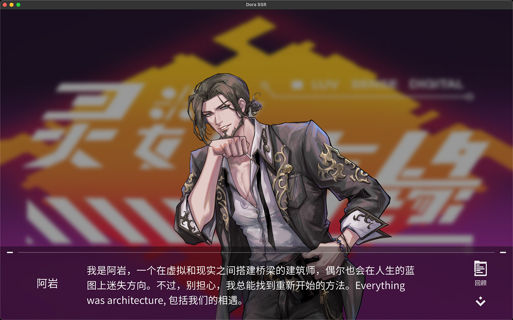

# 多萝故事引擎 (Dora Story Engine)

[![IppClub](https://img.shields.io/badge/I%2B%2B%E4%BF%B1%E4%B9%90%E9%83%A8-%E8%AE%A4%E8%AF%81-11A7E2?logo=data%3Aimage%2Fsvg%2Bxml%3Bcharset%3Dutf-8%3Bbase64%2CPHN2ZyB2aWV3Qm94PSIwIDAgMjg4IDI3NCIgeG1sbnM9Imh0dHA6Ly93d3cudzMub3JnLzIwMDAvc3ZnIiB4bWw6c3BhY2U9InByZXNlcnZlIiBzdHlsZT0iZmlsbC1ydWxlOmV2ZW5vZGQ7Y2xpcC1ydWxlOmV2ZW5vZGQ7c3Ryb2tlLWxpbmVqb2luOnJvdW5kO3N0cm9rZS1taXRlcmxpbWl0OjIiPjxwYXRoIGQ9Im0xNDYgMzEgNzIgNTVWMzFoLTcyWiIgc3R5bGU9ImZpbGw6I2Y2YTgwNjtmaWxsLXJ1bGU6bm9uemVybyIvPjxwYXRoIGQ9Im0xNjkgODYtMjMtNTUgNzIgNTVoLTQ5WiIgc3R5bGU9ImZpbGw6I2VmN2EwMDtmaWxsLXJ1bGU6bm9uemVybyIvPjxwYXRoIGQ9Ik0yNiAzMXY1NWg4MEw4MSAzMUgyNloiIHN0eWxlPSJmaWxsOiMwN2ExN2M7ZmlsbC1ydWxlOm5vbnplcm8iLz48cGF0aCBkPSJNMTA4IDkydjExMmwzMS00OC0zMS02NFoiIHN0eWxlPSJmaWxsOiNkZTAwNWQ7ZmlsbC1ydWxlOm5vbnplcm8iLz48cGF0aCBkPSJNMCAyNzR2LTUyaDk3bC0zMyA1MkgwWiIgc3R5bGU9ImZpbGw6I2Y2YTgwNjtmaWxsLXJ1bGU6bm9uemVybyIvPjxwYXRoIGQ9Im03NyAyNzQgNjctMTA3djEwN0g3N1oiIHN0eWxlPSJmaWxsOiNkZjI0MzM7ZmlsbC1ydWxlOm5vbnplcm8iLz48cGF0aCBkPSJNMTUyIDI3NGgyOWwtMjktNTN2NTNaIiBzdHlsZT0iZmlsbDojMzM0ODVkO2ZpbGwtcnVsZTpub256ZXJvIi8%2BPHBhdGggZD0iTTE5MSAyNzRoNzl2LTUySDE2N2wyNCA1MloiIHN0eWxlPSJmaWxsOiM0ZTI3NWE7ZmlsbC1ydWxlOm5vbnplcm8iLz48cGF0aCBkPSJNMjg4IDEwMGgtMTdWODVoLTEzdjE1aC0xN3YxM2gxN3YxNmgxM3YtMTZoMTd2LTEzWiIgc3R5bGU9ImZpbGw6I2M1MTgxZjtmaWxsLXJ1bGU6bm9uemVybyIvPjxwYXRoIGQ9Im0yNiA4NiA1Ni01NUgyNnY1NVoiIHN0eWxlPSJmaWxsOiMzMzQ4NWQ7ZmlsbC1ydWxlOm5vbnplcm8iLz48cGF0aCBkPSJNOTMgMzFoNDJsLTMwIDI5LTEyLTI5WiIgc3R5bGU9ImZpbGw6IzExYTdlMjtmaWxsLXJ1bGU6bm9uemVybyIvPjxwYXRoIGQ9Ik0xNTggMTc2Vjg2bC0zNCAxNCAzNCA3NloiIHN0eWxlPSJmaWxsOiMwMDU5OGU7ZmlsbC1ydWxlOm5vbnplcm8iLz48cGF0aCBkPSJtMTA2IDU5IDQxLTEtMTItMjgtMjkgMjlaIiBzdHlsZT0iZmlsbDojMDU3Y2I3O2ZpbGwtcnVsZTpub256ZXJvIi8%2BPHBhdGggZD0ibTEyNCAxMDAgMjItNDEgMTIgMjctMzQgMTRaIiBzdHlsZT0iZmlsbDojNGUyNzVhO2ZpbGwtcnVsZTpub256ZXJvIi8%2BPHBhdGggZD0ibTEwNiA2MCA0MS0xLTIzIDQxLTE4LTQwWiIgc3R5bGU9ImZpbGw6IzdiMTI4NTtmaWxsLXJ1bGU6bm9uemVybyIvPjxwYXRoIGQ9Im0xMDggMjA0IDMxLTQ4aC0zMXY0OFoiIHN0eWxlPSJmaWxsOiNiYTAwNzc7ZmlsbC1ydWxlOm5vbnplcm8iLz48cGF0aCBkPSJtNjUgMjc0IDMzLTUySDBsNjUgNTJaIiBzdHlsZT0iZmlsbDojZWY3YTAwO2ZpbGwtcnVsZTpub256ZXJvIi8%2BPHBhdGggZD0iTTc3IDI3NGg2N2wtNDAtNDUtMjcgNDVaIiBzdHlsZT0iZmlsbDojYTgxZTI0O2ZpbGwtcnVsZTpub256ZXJvIi8%2BPHBhdGggZD0iTTE2NyAyMjJoNThsLTM0IDUyLTI0LTUyWiIgc3R5bGU9ImZpbGw6IzExYTdlMjtmaWxsLXJ1bGU6bm9uemVybyIvPjxwYXRoIGQ9Im0yNzAgMjc0LTQ0LTUyLTM1IDUyaDc5WiIgc3R5bGU9ImZpbGw6IzA1N2NiNztmaWxsLXJ1bGU6bm9uemVybyIvPjxwYXRoIGQ9Ik0yNzUgNTVoLTU3VjBoMjV2MzFoMzJ2MjRaIiBzdHlsZT0iZmlsbDojZGUwMDVkO2ZpbGwtcnVsZTpub256ZXJvIi8%2BPHBhdGggZD0iTTE4NSAzMWg1N3Y1NWgtMjVWNTVoLTMyVjMxWiIgc3R5bGU9ImZpbGw6I2M1MTgxZjtmaWxsLXJ1bGU6bm9uemVybyIvPjwvc3ZnPg%3D%3D&labelColor=fff)](https://ippclub.org)



&emsp;&emsp;多萝故事引擎是一个基于 Dora SSR 开发的视觉小说游戏框架。本框架整合了 Yarn Spinner 对话系统，并采用了开源游戏《灵数奇缘》的代码与授权美术资源，为视觉小说游戏开发提供完整的解决方案。

## 使用指南

1. **安装 Dora SSR 引擎**

	&emsp;&emsp;从[此处](https://gitcode.com/ippclub/Dora-SSR/releases)下载最新的发布程序。请参阅[说明文档](https://ippclub.atomgit.net/Dora-SSR/zh-Hans/docs/tutorial/quick-start/)以完成游戏引擎的安装和启动。

2. **获取项目文件**

	&emsp;&emsp;克隆或下载本项目的文件。通过 Dora SSR 的 Web IDE 界面，使用左侧的资源管理器上传项目文件夹或压缩包，将其导入到 Dora SSR 引擎中。如果是上传 Zip 压缩包，记得进行解压。

3. **启动游戏**

	&emsp;&emsp;在 Dora SSR 的 Web IDE 界面中，点击右下角的“启动游戏”按钮，即可开始游戏体验。

## 增加的 Yarn Spinner 对话系统指令

&emsp;&emsp;本项目在原版 Dora SSR 的 Yarn Spinner 对话系统基础上，增加了下面的指令。Yarn Spinner 是一门极简的对话脚本语言，可以参考这篇[教学](https://ippclub.atomgit.net/Dora-SSR/zh-Hans/docs/tutorial/Writing%20Game%20Dialogue/introduction-to-yarn)快速上手。

* **玩家姓名输入框**

	```
	<<inputName>>
	```

	&emsp;&emsp;用于弹出玩家姓名输入框，并将输入的姓名作为变量存储在 `$charName` 中。

* **背景图片**

	```
	<<background "Image/bg_001.png", true>>
	```

	&emsp;&emsp;用于设置背景图片。第一个参数为背景图片路径，第二个参数为是否对背景图片进行模糊处理。

	```
	<<noBackground>>
	```

	&emsp;&emsp;用于隐藏当前正在展示的背景图片。

* **角色立绘**

	```
	<<figure "Image/ch_001.png", 0, 200, 1.5>>
	```

	&emsp;&emsp;用于设置角色立绘。第一个参数为角色立绘图片路径，第二个参数为立绘图片的 X 轴偏移量，第三个参数为立绘图片的 Y 轴偏移量，第四个参数为立绘图片的缩放比例。

	```
	<<noFigure>>
	```

	&emsp;&emsp;用于隐藏当前画面中已经展示的角色立绘图片。

* **播放帧动画**

	```
	<<frame "Animation/frame_001", 1.0, 0, 500, 1.5, true>>
	```

	&emsp;&emsp;用于播放帧动画。第一个参数为帧动画文件夹路径，第二个参数为帧动画播放时间，第三个参数为帧动画 X 轴偏移量是否循环播放，第四个参数为帧动画 Y 轴偏移量，第五个参数为帧动画缩放比例，第六个参数为是否循环播放。

	```
	<<noFrame>>
	```

	&emsp;&emsp;用于隐藏当前画面中已经在播放的帧动画。

* **背景音乐**

  ```
  <<BGM "Music/军事学园.mp3">>
  ```

  &emsp;&emsp;用于设置背景音乐。第一个参数为背景音乐路径。

* **播放音效**

  ```
  <<SE "Sound/door_knock.wav">>
  ```

  &emsp;&emsp;用于播放音效。第一个参数为音效文件路径。

* **停止背景音乐**

	```
	<<stopBGM>>
	```

	&emsp;&emsp;用于停止背景音乐。

* **启动下一个章节**

	```
	<<chapter "tutorial.yarn">>
	```

	&emsp;&emsp;用于启动下一个章节。第一个参数为章节文件路径。启动下一个章节时，会自动停止当前章节。并更新记录当前进行的章节，在下次启动时，会从当前章节继续。

* **预加载资源**

	```
	<<preload "Image/bg_001.png">>
	<<preload "moling">>
	```

	&emsp;&emsp;用于预加载资源，会在下一个对话语句开始展现的时候开始异步预加载指定资源，避免用户在交互时有卡顿感。第一个参数可以为资源路径，也可以为项目带的 Spine 立绘的资源名称。当前可用的立绘资源名有：

	- char
	- charF
	- charM
	- ninilite
	- ayan
	- villywan
	- moling
	- moyu
	- liyena
	- sunborn
	- wuyun
	- vika
	- vivi
	- yuzijiang

	另外也可以通过 `<preload "Animation/frame_001">` 这样的格式，预加载项目里的帧动画资源。

* **使用项目自带的 Spine 立绘**

	```
	[char id=moling name=默翎] 午夜是我的主场，实验室比床更适合我——如果有事，直说，别绕弯子。
	```

	&emsp;&emsp;通过 `[char id=moling name=默翎]` 这样的格式，`id=` 后面为项目自带的 Spine 立绘的资源名称，需要对应准确名称，`name=` 后面为给对话人物起的名称可以做任意设置。这样可以在提供对话人物名称的同时调用展示项目自带的 Spine 立绘。

## 如何使用自动存储的 Yarn Spinner 变量

&emsp;&emsp;当前框架会自动存储 Yarn Spinner 变量，并会在下次启动程序时自动读取。需要把用到的变量额外配置在 `Script/Data/Config.tl` 中。请找到以下代码位置做修改：

```lua
local conf = Config(
	"story", -- 数据库名
	"charName", -- 玩家名字
	"chapter", -- 当前章节
	-- 以上为框架保留变量，在下面根据自己的需要补充新的变量
	"gold", -- 教学对话测试用临时变量
	"name" -- 教学对话测试用临时变量
)
```

&emsp;&emsp;如上所示，就可以在 Yarn Spinner 脚本中这样使用这些变量。并在变量发生变化时，自动存储变量到数据库中。

```
<<set $gold to 100>>
金币数量为：{$gold}。
玩家名字为：{$charName}。
```

## 版权声明

&emsp;&emsp;本项目使用了《灵数奇缘》的游戏代码及授权的美术资源。

## 关联项目

- [Dora SSR 引擎](https://gitcode.com/ippclub/Dora-SSR)
- [灵数奇缘美术资源](https://gitcode.com/ippclub/LSD-spine-2x)
- [YarnFlow](https://gitcode.com/ippclub/YarnFlow) - 想要在其它 Lua 环境中使用 Yarn Spinner 语言可以试试这个库.

## 开源协议

&emsp;&emsp;本项目遵循 [MIT 开源协议](LICENSE)。
